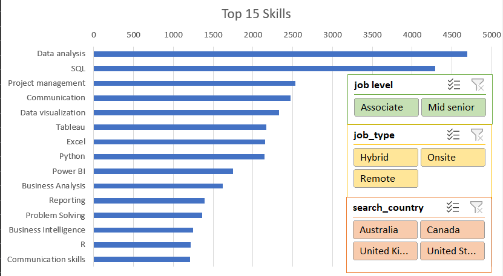
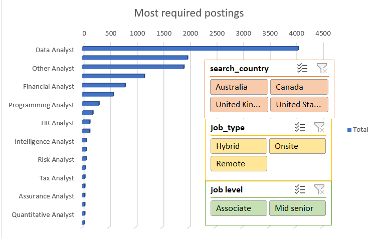
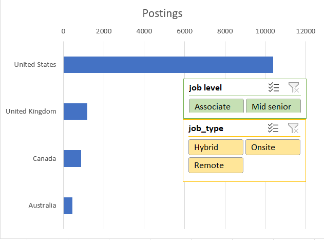
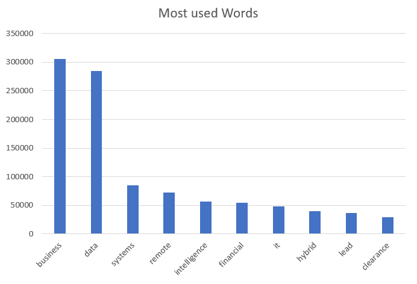

# MDBR Global Job Market Intelligence

**An Excel-based analysis of 12,894 global job postings — Power Query, Power Pivot, and DAX.**

---

| Project | Details |
|---|---|
| **Maintainer** | Mohammed Haji Mudabbir |
| **Contact** | [mohammedhajimudabbir@gmail.com](mailto:mohammedhajimudabbir@gmail.com) |
| **Repository** | `MDBR-Global-Job-Market-Analytics` |
| **Project type** | Data Analyst portfolio project |
| **License** | MIT — see [`Documentation/LICENSE`](Documentation/LICENSE) |
| **Original attribution** | Mohith-akash — see [Attribution & License](#attribution--license) |

## Overview

MDBR Global Job Market Intelligence is a Data Analyst portfolio project built around a dataset of **12,894 unique job postings**. The original workbook transforms approximately 60 MB of raw, messy data into an interactive, multi-chart dashboard using **Power Query**, the **Power Pivot Data Model**, and **DAX**.

This repository preserves the original analytical work and presents it under the MDBR project identity. The workbook, dataset, formulas, data model, and dashboard are unchanged.

> **Scope note:** The MDBR branding, maintainer metadata, and new documentation were added for project identity and presentation. The original analysis and dashboard remain the work of the original author, attributed below.

## Dashboard Preview

Screenshots from the original interactive dashboard:

| Top 15 Skills | Most Required Postings |
|---|---|
|  |  |

| Job Postings by Country | Most Used Words |
|---|---|
|  |  |

## Key Findings

The figures below are documented in the original project README:

- **12,894** unique job postings analyzed.
- **228,745** individual skill mentions processed.
- Top skills: **Data Analysis**, **SQL**, and **Project Management**.
- **6,797** distinct job titles standardized into approximately **20** roles.
- Top roles: **Data Analyst** (4,058), **Business Analyst** (1,978), and **System Analyst** (1,167).
- **3.1+ million** words processed; top keywords include **business** (305k), **data** (284k), and **systems** (85k).
- **10,386** postings from the **United States**.

## Technical Scope

The original workbook demonstrates an end-to-end Excel analytics workflow:

- **Power Query:** 70+ sequential transformation steps, conditional columns, and split/unpivot operations.
- **Power Pivot and DAX:** a data model with a custom `DISTINCTCOUNT` measure to count unique postings across the expanded skills table.
- **Dashboarding:** four PivotCharts connected to three master slicers (`job_level`, `job_type`, and `search_country`).
- **Version control:** Git LFS configured for the workbook and CSV assets.

## Repository Structure

```text
MDBR_Global_Job_Market_Analytics/
├── Data/
│   └── raw_postings.csv
├── Documentation/
│   ├── LICENSE
│   ├── PROJECT_METADATA.md
│   ├── README_Original.md
│   ├── dashboard_1.png
│   ├── dashboard_2.png
│   ├── dashboard_3.png
│   └── dashboard_4.png
├── Excel/
│   ├── MDBR_Global_Job_Market_Analytics.xlsx
│   └── archive/
│       └── MDBR_Global_Job_Market_Analytics_ORIGINAL_2025-10-31.xlsx
├── .gitattributes
└── README.md
```

## Viewing the Project

1. Open `Excel/MDBR_Global_Job_Market_Analytics.xlsx` in Microsoft Excel.
2. Enable Power Query and Power Pivot if prompted by your Excel configuration.
3. Use the dashboard slicers to filter by job level, job type, and search country.

## Documentation

- **This README** — project overview, maintainer details, dashboard preview, and attribution.
- [`Documentation/README_Original.md`](Documentation/README_Original.md) — the original project README, preserved verbatim.
- [`Documentation/PROJECT_METADATA.md`](Documentation/PROJECT_METADATA.md) — canonical project identity, naming, maintainer, and attribution metadata.
- [`Documentation/LICENSE`](Documentation/LICENSE) — the original MIT license, preserved unchanged.

## Attribution & License

**Current maintainer:** Mohammed Haji Mudabbir — [mohammedhajimudabbir@gmail.com](mailto:mohammedhajimudabbir@gmail.com)

**Original project attribution and copyright holder:** Mohith-akash, Copyright (c) 2025, as stated in the original MIT LICENSE.

The original analysis, Excel workbook, dashboard, and original README remain the work of the original author. The MDBR branding, maintainer metadata, and new documentation in this repository do not claim authorship of the original analytical work.

The original MIT license is preserved unchanged in [`Documentation/LICENSE`](Documentation/LICENSE). The original project documentation is preserved in [`Documentation/README_Original.md`](Documentation/README_Original.md).

## Contact

**Mohammed Haji Mudabbir**  
Project Maintainer  
[mohammedhajimudabbir@gmail.com](mailto:mohammedhajimudabbir@gmail.com)

---

Maintained by **Mohammed Haji Mudabbir** · [mohammedhajimudabbir@gmail.com](mailto:mohammedhajimudabbir@gmail.com)
